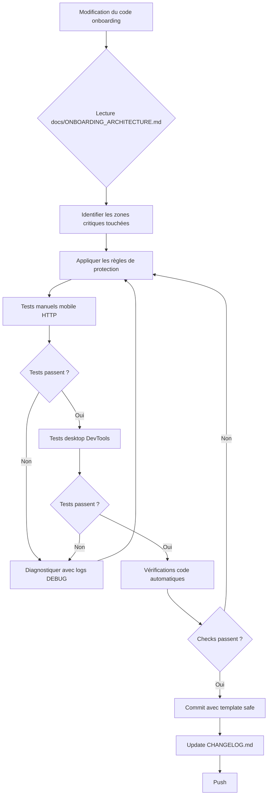

# Skill: Onboarding Guard

## 🎯 Objectif
Prévenir les régressions sur le parcours d'onboarding de Famili-IA lors de toute modification du code.

## 🚨 Quand Utiliser Ce Skill

**Déclencher AUTOMATIQUEMENT ce skill quand :**
- On modifie `app.js` lignes 1-400 (zone d'initialisation)
- On touche à `initOnboardingWizard()`, `manageOnboardingWizardVisibility()`, ou `isOnboardingComplete()`
- On change l'ordre des déclarations de variables globales (`uploadedDocuments`, `activeView`)
- On modifie le bloc d'initialisation asynchrone (ligne ~337)
- On touche à `state.js` → `initState()`
- On modifie `crypto.js` (chiffrement)
- On change les styles CSS de `.onboarding-page-white`
- On modifie la structure HTML du wizard (`#onboarding-wizard`)

## ⚠️ Règles de Protection Absolues

### 1. ORDRE DE DÉCLARATION DES VARIABLES (NON NÉGOCIABLE)

```javascript
// ✅ BON ORDRE (respecter impérativement)
const uploadedDocuments = [];           // Ligne ~574
// ... autres déclarations ...
let activeView = (() => { ... })();     // Ligne ~1348
// ... autres déclarations ...
(async () => {
  await initState();
  initOnboardingWizard();               // Ligne ~362 - APRÈS uploadedDocuments et activeView
})();
```

**❌ NE JAMAIS :**
- Appeler `initOnboardingWizard()` avant la ligne 1348
- Créer un bloc d'initialisation synchrone qui appelle `initOnboardingWizard()` avant le bloc async
- Déplacer `uploadedDocuments` ou `activeView` après leur première utilisation

**Erreur typique à éviter :**
```
ReferenceError: Cannot access 'activeView' before initialization
```

### 2. TIMEOUT SUR initState() (OBLIGATOIRE)

```javascript
// ✅ TOUJOURS utiliser Promise.race avec timeout
const initStatePromise = initState();
const timeoutPromise = new Promise((_, reject) => 
  setTimeout(() => reject(new Error('initState() timeout after 5s')), 5000)
);
const stateResult = await Promise.race([initStatePromise, timeoutPromise]);
```

**Pourquoi ce timeout est CRITIQUE :**
- Sur mobile HTTP (192.168.x.x), `crypto.subtle` est `undefined`
- Sans timeout, `initState()` bloque **indéfiniment**
- L'utilisateur voit une page blanche, l'app est inutilisable

**❌ NE JAMAIS :**
- Supprimer le timeout sans tester sur smartphone réel en HTTP
- Augmenter le timeout au-delà de 10 secondes (mauvaise UX)
- Retirer le fallback `catch` qui initialise l'onboarding quand même

### 3. FALLBACK CRYPTO.SUBTLE (OBLIGATOIRE)

```javascript
// ✅ crypto.js DOIT vérifier la disponibilité
const isCryptoAvailable = typeof crypto !== 'undefined' && 
                          typeof crypto.subtle !== 'undefined' &&
                          crypto.subtle !== null;

export async function encryptData(data) {
  if (!isCryptoAvailable) {
    console.warn('[CRYPTO] Encryption skipped - crypto.subtle not available');
    return data; // Stockage en clair en fallback
  }
  // ... chiffrement normal
}
```

**Pourquoi :**
- `crypto.subtle` n'existe qu'en HTTPS ou localhost
- En HTTP mobile, il est `undefined`
- Sans fallback, l'app crash au démarrage

**❌ NE JAMAIS :**
- Appeler `crypto.subtle` sans vérifier sa disponibilité d'abord
- Lever une erreur si crypto.subtle est absent (bloquerait l'app)

### 4. CSS Z-INDEX (CRITIQUE)

```css
.onboarding-page-white {
  z-index: 2000; /* MINIMUM 2000 pour couvrir topbar et bottom-nav */
  position: fixed;
  touch-action: manipulation; /* Réactivité tactile mobile */
}
```

**❌ NE JAMAIS :**
- Réduire le z-index en dessous de 1500
- Supprimer `position: fixed`
- Retirer `touch-action: manipulation` (boutons non cliquables sur mobile)

### 5. VALIDATION localStorage (OBLIGATOIRE)

```javascript
// ✅ TOUJOURS wrapper dans try/catch
function isOnboardingComplete() {
  try {
    return localStorage.getItem(onboardingCompleteKey) === "true";
  } catch (e) {
    return false; // Fallback si localStorage indisponible
  }
}
```

**Pourquoi :**
- localStorage peut être désactivé (mode privé, restrictions)
- Sans try/catch, l'app crash si localStorage indisponible

## 🧪 Checklist de Validation OBLIGATOIRE

**Avant de commiter TOUTE modification touchant l'onboarding :**

### Tests Manuels (OBLIGATOIRES)

#### Test 1 : Premier Lancement Mobile HTTP
1. Smartphone réel connecté en HTTP (192.168.x.x:5179)
2. Ouvrir DevTools mobile → Application → Local Storage → Supprimer `famili-ia-source-choice-complete`
3. Recharger la page
4. **Attendu** : Le wizard s'affiche en plein écran en < 2 secondes
5. **Vérifier console** :
   ```
   [CRYPTO] crypto.subtle available: false
   [DEBUG] Async init - START
   [DEBUG] Async init - initState done
   [DEBUG] initOnboardingWizard - START
   [DEBUG] manageOnboardingWizardVisibility: { shouldShow: true }
   ```

#### Test 2 : Navigation Entre Étapes
1. Cliquer "Continuer" (étape 0 → 1) : **DOIT fonctionner**
2. Laisser prénom/ville vides, cliquer "Continuer" : **DOIT bloquer avec message**
3. Remplir prénom/ville, cliquer "Continuer" (étape 1 → 2) : **DOIT fonctionner**
4. Titre étape 2 **DOIT** afficher "Bonjour {prénom}, comment souhaitez-vous démarrer ?"

#### Test 3 : Mode Démo
1. Cliquer "Explorer la démo"
2. **Attendu** : Visite guidée démarre automatiquement
3. Après la visite, **DOIT** retourner à l'étape 3 de l'onboarding
4. `localStorage.getItem("famili-ia-source-choice-complete")` **DOIT** être `"true"`

#### Test 4 : Retour Après Onboarding Complété
1. Recharger la page
2. **Attendu** : Wizard **NE DOIT PAS** s'afficher (accès direct au dashboard)

### Tests Desktop (Chrome DevTools)
1. F12 → Toggle Device Toolbar → iPhone 12 Pro
2. Répéter les tests 1-4 ci-dessus
3. Tester aussi en mode "Network: Slow 3G" pour vérifier le timeout

### Vérifications Code (AUTOMATIQUES)

**Lancer ces vérifications avant tout commit :**

```bash
# 1. Vérifier l'ordre des déclarations critiques
grep -n "const uploadedDocuments" projets/famili-ia/app.js
grep -n "let activeView" projets/famili-ia/app.js
grep -n "initOnboardingWizard()" projets/famili-ia/app.js

# 2. Vérifier la présence du timeout
grep -A 3 "Promise.race" projets/famili-ia/app.js | grep "timeout"

# 3. Vérifier le fallback crypto
grep -n "isCryptoAvailable" projets/famili-ia/crypto.js

# 4. Vérifier le z-index CSS
grep -A 2 "\.onboarding-page-white {" projets/famili-ia/styles.css | grep "z-index: 2000"
```

**Si l'une de ces commandes échoue → STOP, ne pas commiter.**

## 🚫 Erreurs Connues À Éviter

### Erreur #1 : ReferenceError activeView
**Symptôme** : `ReferenceError: Cannot access 'activeView' before initialization`

**Cause** : Appel de `initOnboardingWizard()` ou `manageOnboardingWizardVisibility()` avant la ligne ~1348

**Solution** : S'assurer que `initOnboardingWizard()` n'est appelé QUE dans le bloc async, après `await initState()`

### Erreur #2 : Wizard ne s'affiche pas sur mobile
**Symptôme** : Console affiche `[DEBUG] Async init - START` puis plus rien

**Cause** : `initState()` bloque indéfiniment à cause de crypto.subtle undefined

**Solution** : Vérifier que le timeout `Promise.race()` est présent ET que `crypto.js` a le fallback `isCryptoAvailable`

### Erreur #3 : Boutons non cliquables sur mobile
**Symptôme** : Les boutons du wizard ne répondent pas aux taps

**Causes possibles :**
1. `z-index` trop faible (un autre élément couvre le wizard)
2. `touch-action` manquant sur les boutons
3. `min-height: 44px` manquant (cible tactile trop petite)

**Solution** : Vérifier les styles CSS dans la media query `@media (max-width: 600px)`

### Erreur #4 : localStorage non persistant
**Symptôme** : L'onboarding se relance à chaque rechargement

**Cause** : `completeOnboarding()` n'écrit pas dans localStorage OU mode privé navigateur

**Solution** : Vérifier que `localStorage.setItem(onboardingCompleteKey, "true")` est appelé

## 📋 Templates de Commit Safe

**Quand on modifie du code lié à l'onboarding, utiliser ces templates de commit :**

```bash
# Modification mineure (styles, textes)
git commit -m "fix(onboarding): adjust button padding for mobile

- Increase touch target to 48px (from 44px)
- Tested on iPhone 12 Pro (Chrome DevTools)
- No functional change

Related: docs/ONBOARDING_ARCHITECTURE.md"

# Modification structurelle (logique, ordre d'init)
git commit -m "refactor(onboarding): improve init sequence robustness

BREAKING CHANGE: initOnboardingWizard now called after initState

- Move initOnboardingWizard call inside async block
- Add timeout on initState (5s) to prevent freeze on mobile HTTP
- Add fallback in crypto.js for undefined crypto.subtle

Tested:
- ✅ Mobile HTTP (192.168.0.25:5179)
- ✅ Desktop Chrome DevTools iPhone 12 Pro
- ✅ localStorage persistence

Fixes #<issue-number>
Refs: docs/ONBOARDING_ARCHITECTURE.md"
```

## 📚 Documentation de Référence

**LIRE AVANT toute modification de l'onboarding :**
- `docs/ONBOARDING_ARCHITECTURE.md` : Architecture complète, diagrammes de séquence
- `CLAUDE.md` : Charte graphique, checklist anti-régression
- `DEVELOPPEMENT_PLAN.md` : Phase 13 (Refonte Onboarding)

## 🔄 Workflow Recommandé



## 🎓 Principes de Design Safe

1. **Défensif** : Prévoir que crypto.subtle, localStorage, IndexedDB peuvent échouer
2. **Fallback** : Toujours avoir un plan B (ex: stockage en clair si crypto.subtle absent)
3. **Timeout** : Ne jamais attendre indéfiniment une promesse (ex: initState avec timeout 5s)
4. **Logs** : Garder les logs `[DEBUG]` pour diagnostiquer les problèmes en production
5. **Incrémental** : Tester sur mobile HTTP après CHAQUE modification (pas seulement à la fin)

## 🆘 En Cas de Régression Détectée

**Si un utilisateur signale que l'onboarding ne fonctionne plus :**

### Diagnostic Rapide (5 minutes)
1. Demander les logs de la console (smartphone)
2. Vérifier si `[DEBUG] initOnboardingWizard - START` apparaît
3. Chercher les erreurs `ReferenceError`, `TypeError`, ou timeout

### Actions Correctives Immédiates
1. **Si ReferenceError activeView** → Vérifier ordre des déclarations (ligne 1348 vs appel)
2. **Si timeout initState** → Vérifier fallback crypto.js (ligne ~14)
3. **Si wizard masqué** → Vérifier `manageOnboardingWizardVisibility` (activeView === 'accueil')
4. **Si boutons non cliquables** → Vérifier z-index CSS (2000) et touch-action

### Rollback d'Urgence
```bash
# Identifier le dernier commit fonctionnel
git log --oneline --grep="onboarding" -10

# Rollback au dernier état stable
git revert <commit-hash>

# Ou reset si nécessaire (⚠️ perte des changements)
git reset --hard <commit-hash-stable>
```

## 📊 Métriques de Qualité

**Objectifs à maintenir :**
- ✅ Taux de complétion onboarding : > 85%
- ✅ Temps d'affichage wizard (mobile HTTP) : < 2s
- ✅ Zéro erreur JS au démarrage (console mobile)
- ✅ Compatibilité : iOS Safari 14+, Android Chrome 90+

---

**Version** : 1.0  
**Dernière mise à jour** : 2026-11-01  
**Mainteneur** : Équipe Famili-IA
