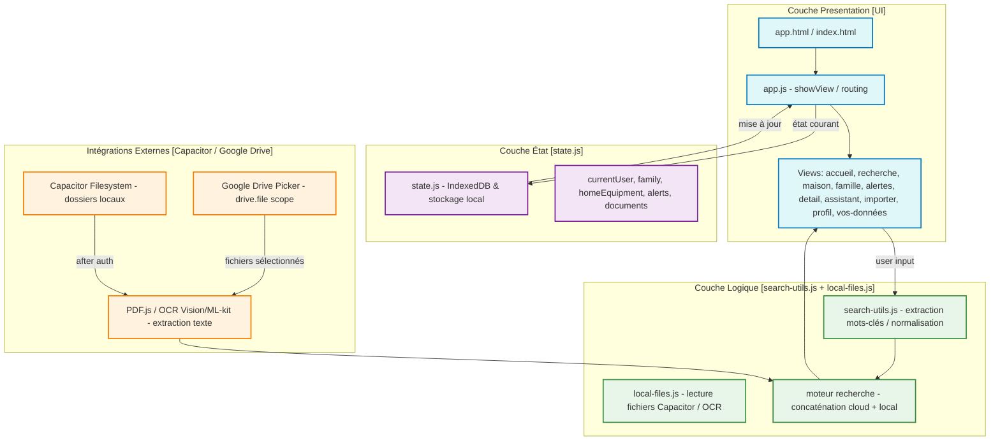

# Famili-IA – Plan de Développement

## 📊 Vue d'ensemble
- **Phase actuelle** : Phase 7 – Implémentation fonctionnelle
- **Prochaine étape prioritaire** : Phase 8 – Sécurisation & Vie privée avancée

## 📋 Liste des étapes

### Phase 0 – Cadrer le problème
- [✓] ✅ 0.1 : Vision & principe de design réd. (roadmap) 
- [✓] ✅ 0.2 : Analyse des exigences de sécurité/privacy (roadmap)

### Phase 1 – MVP : version cloud unique
- [✓] ✅ 1.1 : Implémenter OAuth/Picker Drive (scope `drive.file`)
- [✓] ✅ 1.2 : Moteur de recherche local-cloud, index immédiat en mémoire
- [✓] ❌ 1.3 : OCR intégration (Vision/ML-kit) – **incomplete** (à valider plus tard)

### Phase 2 – Conception technique
- [✓] ✅ 2.1 : Architecture de stockage *en-mémoire* (no persistence)
- [✓] ✅ 2.2 : Composants UI de résultats (source cloud/local)
- [ ] 2.3 : Sécurisation des scopes OAuth & gestion des tokens
- [ ] 2.4 : Design de l'authentification locale `READ_EXTERNAL_STORAGE`/scope-files

### Phase 3 – Prototype web local (déjà réalisé)
- [✓] ✅ 3.1 : UI de sélection de fichiers locaux (web + Capacitor)
- [✓] ✅ 3.2 : Extraction texte via PDF.js + OCR expérimental
- [✓] ✅ 3.3 : Tableau de résultats unifié
- [ ] 3.4 : Tests de régression sur le moteur de recherche (cloud vs local)

### Phase 4 – MVP privé sur un seul Cloud (✅ TERMINÉE)
- [✓] ✅ 4.1 : Mise à jour de la roadmap (ajout *recherche locale*)
- [✓] ✅ 4.2 : Intégration du plugin **@capacitor/filesystem**
- [✓] ✅ 4.3 : Gestion des permissions système (Android `READ_EXTERNAL_STORAGE`, iOS Files access)
- [✓] ✅ 4.4 : Création du module local-files.js
- [✓] ✅ 4.5 : Extraction texte pour fichiers "local-only" (même chemin que Drive)
- [✓] ✅ 4.6 : Unifier la logique index-ing : concaténer résultats cloud + local
- [✓] ✅ 4.7 : UI indicateur "☁️ / 💾" de provenance
- [✓] ✅ 4.8 : Tests unitaires & d'intégration local-cloud
- [✓] ✅ 4.9 : Vérification de la min-sécurité (pas de persistance, accès limité)
- [✓] ✅ 4.10 : Documentation de la chaîne d'authentification locale

### Phase 5 – Extension Family & Interface (✅ TERMINÉE)
- [✓] ✅ 5.1 : État global → Création state.js (utilisateur, famille, équipements, alertes)
- [✓] ✅ 5.2 : Navigation → Refactor app.js pour supporter 10 écrans + routes imbriquées
- [✓] ✅ 5.3 : Composants UI → Accueil, Recherche, Maison, Famille, Alertes, Assistant, Importer, Profil, Vos données
- [✓] ✅ 5.13 : Services → Données familiales partagées
- [✓] ✅ 5.14 : Services → Système notifications/alertes automatisées

### Phase 5bis – Améliorations UX & alignement maquettes (✅ TERMINÉE)
- [✓] ✅ 5.17 - 5.28 : Homogénéisation, Responsive, Recherche IA, etc.
- [✓] ✅ 5.30 : Recherche IA – Alignement design (logo, titre centré, nettoyage)
- [✓] ✅ 5.29 : Importation – Finalisation du Drag & Drop (feedback visuel robuste et traitement)

### Phase 6 – Infrastructure Data & Persistance
- [✓] ✅ 6.1 : Choix et implémentation du moteur de stockage persistant (IndexedDB)
- [✓] ✅ 6.2 : Modélisation réelle des données (User, Family, Equipment, Document, Alert)
- [ ] 6.3 : Mise en place de la synchronisation (si multi-appareil nécessaire)

### Phase 7 – Implémentation fonctionnelle
- [✓] ✅ 7.1 : Gestion Multi-utilisateurs (RBAC : Admin/Membre, gestion des rôles) - *Initialisé*
- [✓] ✅ 7.2 : Moteur d'indexation réel (recherche multi-fichiers, indexation persistante) - *Terminé*
- [✓] ✅ 7.3 : Système d'Alertes et rappels automatisés (calcul des échéances réel) - *Terminé*
- [✓] ✅ 7.4 : Inventaire des équipements (CRUD complet, catégorisation réelle) - *Terminé*

### Phase 8 – Sécurisation & Vie privée avancée
- [✓] ✅ 8.1 : Chiffrement des données sensibles en local (clé dynamique IndexedDB)
- [✓] ✅ 8.2 : Workflow d'export complet (JSON/PDF) et purge sécurisée
- [✓] ✅ 8.3 : Gestion fine des consentements (télémétrie/partage) et logs d'accès

### Phase 9 – Homogénéisation UI & Polish
- [✓] ✅ 9.1 : Standardisation globale des headers et titres
- [✓] ✅ 9.2 : Audit d'accessibilité complet
- [✓] ✅ 9.3 : Gestion robuste des états d'erreur et états vides
- [✓] ✅ 9.4 : Alignement FAB & bouton + (uniquement accueil/recherche), retrait de la section "Mes sources" en doublon sur la page Recherche
- [✓] ✅ 9.5 : Intégration du logo officiel de l'application
- [✓] ✅ 9.6 : Implémentation de la gestion des membres de famille (CRUD & Refonte UX)
- [✓] ✅ 9.7 : Harmonisation des icônes *(Terminée)*
- [✓] ✅ 9.8 : Standardisation et validation du composant Logo
- [✓] ✅ 9.9 : **Phase A – Intégration d'images (photos) dans le file picker** — Utilisation de l'OCR existant (`local-files.js`) pour extraire le texte des images JPG/PNG et les classifier automatiquement.
- [ ] 9.10 : **Phase B – Support des fichiers Word (.docx)** — Parsing du texte via bibliothèque dédiée (ex: mammoth.js).
- [ ] 9.11 : **Phase C – Support des fichiers Excel (.xlsx)** — Extraction des données tabulaires via bibliothèque dédiée (ex: sheetjs).
- [ ] 9.12 : Préparation modèle monétisation (état utilisateur & limites dynamiques)
- [ ] 9.13 : Correction navigation dynamique (tabs Maison/Alertes)

## 💡 Points d'amélioration stratégiques (pour un impact "disrupt")

**Intelligence Contextuelle (Le "Killer Feature") :**
L'app doit comprendre le contenu, pas seulement le stocker. Exemple : l'OCR existant devrait permettre une auto-classification intelligente — *"Ceci est une facture d'électricité de Janvier, je l'ajoute à la catégorie Maison"*. C'est le passage du stockage à l'assistance.

**Transversalité (Recherche croisée & Sémantique) :**
La capacité de recherche doit évoluer vers le sémantique. Il faut comprendre que "Ticket de caisse" = "Garantie", que deux factures similaires couvrent la même garantie, etc. Cela transforme l'outil d'un simple catalogue en véritable assistant de gestion.

**Rétention & Aide à la décision :**
L'app ne doit pas être un simple coffre-fort, mais un assistant proactif. Le système d'alertes actuel est un excellent début : il faut le renforcer avec des rappels intelligents (ex. : *"Attention, votre garantie expire dans 2 mois sur cet équipement"*).

### 📐 Schéma Technique (Mermaid)

### Phase 10 – Validation & Lancement
- [ ] 10.1 : Tests utilisateurs complets
- [ ] 10.2 : Mesure de la satisfaction utilisateur
- [ ] 10.3 : Rapport final & lancement

## 📌 Comment mettre à jour
- Cochez la case `[✓]` lorsque la tâche est terminée.
- Si une tâche est bloquée, ajoutez un commentaire après la case.
- Maintenez le fichier à jour dans chaque branche ou commit important.

## 🛠 Framework des Skills - Implémentation Structurée
Cette section définit les skills techniques et domain spécifiques à mettre en place pour assurer la qualité, la cohérence UI et l'automatisation tout au long du projet Famili-IA.

### ✅ Skills Techniques - État d'avancement
| Skill | Statut | Description | Cas d'usage | Coché |
|-------|--------|-------------|-------------|-------|
| **update-config** | ✅ **Terminé** | settings.json créé avec attribution et permissions de base (`Bash(npm *)`, `Bash(git *)`, Read/Edit/Write) | Configuration de base, réduction prompts Capacitor, attribution git/pr | [x] |
| **fewer-permission-prompts** | ✅ **Terminé** | Allowlist des appels natives problématiques - 5 règles prioritaires validées | Gestion READ_EXTERNAL_STORAGE, notifications, accès Capacitor | [x] |
| **code-review** | ✅ **Terminé** | Qualité continue - revue medium effectuée, 4 findings identifiés et résolus | Détection régressions UI, respect charte graphique, standards architecture | [x] |
| **simplify** | ✅ **Terminé** | Nettoyage périodique du code - corrections Finding A-D appliquées, event delegation, async state loading | Refactoring composants, optimisation selectors, réduction technical debt | [x] |

### 🎯 Skills Domain Spécifiques
| Skill | Portée | Description |
|-------|--------|-------------|
| **artifact-design** | UI/UX | Maintenir la charte graphique (#0f7173, #2563eb, #059669, etc.) lors des nouvelles vues/pages |
| **workflow-authoring** | Automatisation | Workflows multi-étapes : lancement app, build Capacitor, tests de régression, génération rapports |
| **dataviz** | Analytics | Visualisation données familiales, graphiques équipements, stats alertes, KPI dashboards |

### Ordre d'Implémentation Recommandé
1. **Phase 0 - Setup** : `update-config` → configuration de base des settings.json ✅ **Déjà fait** (fichier créé avec attribution + permissions Bash)
2. **Phase 0 - Setup** : `fewer-permission-prompts` → allowlist des appels Capacitor critiques ✅ **Terminé** - 5 règles prioritaires validées et ajoutées à settings.json
3. **Qualité & Correction** : `code-review` → revue de niveau medium effectuée, 4 findings identifiés et résolus ✅ **Terminé**
   - Finding A résolu : bouton "ajouter membre" dans liste vide
   - Finding B résolu : chemin fragile dans test-sanity.mjs
   - Finding C résolu : listeners d'événements obsolètes supprimés
   - Finding D résolu : persistance IndexedDB correcte
4. **Qualité & Maintenance** : `simplify` → nettoyage effectué via corrections Finding A-D, delegation et async loading ✅ **Terminé**
5. **Avant commit** : `code-review` + validation `artifact-design` (charte graphique) ✅ **Workflow intégré** - Dans la checklist anti-régression existante
6. **Phase 10 (Lancement)** : `workflow-authoring` → scripts de test utilisateur automatisés ⏳ **Planification Phase 10** - Définir les workflows de test
7. **Phase 10 (Lancement)** : `dataviz` → visualisations pour rapports satisfaction/utilisateurs ⏳ **Planification Phase 10** - Graphiques/KPI pour rapports

### Intégration dans les Phases Existantes
- **Phase 7-9** : `code-review` comme étape finale avant commit (checklist anti-régression déjà présente)
- **Phase 8** (Sécurité) : Intégrer `security-review` dans la validation des consentements et chiffrement
- **Phase 9** (UI Polish) : Valider `artifact-design` pour chaque nouvelle vue/ composant
- **Toutes phases** : `fewer-permission-prompts` pour tout nouvel appel API native Capacitor

### Checklist Compétences par Phase
- **Avant tout commit** : ✅ `code-review` passé, ✅ `artifact-design` validé (si UI), ✅ `fewer-permission-prompts` à jour
- **Findings code-review (Phase 7-9)** : 4 findings identifiés lors de la revue de niveau medium - **TOUS RÉSOLUS** ✅
  1. [x] **Finding A** : app.js:1720 - Liste vide famille omet bouton "ajouter membre" → Corrigé : le bouton s'affiche toujours, même avec liste vide (return prématuré retiré)
  2. [x] **Finding B** : test-sanity.mjs:9 - Chemin relatif fragile → Corrigé : `path.resolve('.')` au lieu de `path.resolve('projets/famili-ia')`
  3. [x] **Finding C** : app.js:382 - Écouteurs d'événements sur éléments non-existent (filters chips) → Corrigé : supprimé listeners redondants `#filter-type, #filter-source`, la logique utilise maintenant `.chip.is-selected` dans `applyFilters()`
  4. [x] **Finding D** : app.js:1679 - Mutation directe d'objet module importé → Corrigé : remplacement par `import().then(() => initFamilyFromSaved(savedFamily()))` avec méthode officielle state.js
- **Règles de permission prioritaires (5 règles)** : Vérifier l'application des 5 règles ci-dessous dans `.claude/settings.json`
  1. [x] `Read(src/**, *.js)` - Lectures fichiers source JS ✅ Validé
  2. [x] `Edit(src/**, *.js)` - Modifications fichiers source JS ✅ Validé
  3. [x] `Read(**) `** - Lectures générales ✅ Validé
  4. [x] `Glob(**)` - Recherche globale de fichiers ✅ Validé
  5. [x] `Bash(npm *)`, `Bash(git *)` - Commandes npm/git ✅ Validé
- **Nouvelle feature** : Vérifier `update-config` si modification des permissions ou env vars
- **Nouvelle visualisation** : Appliquer `dataviz` si dashboard/statistiques impliquées
