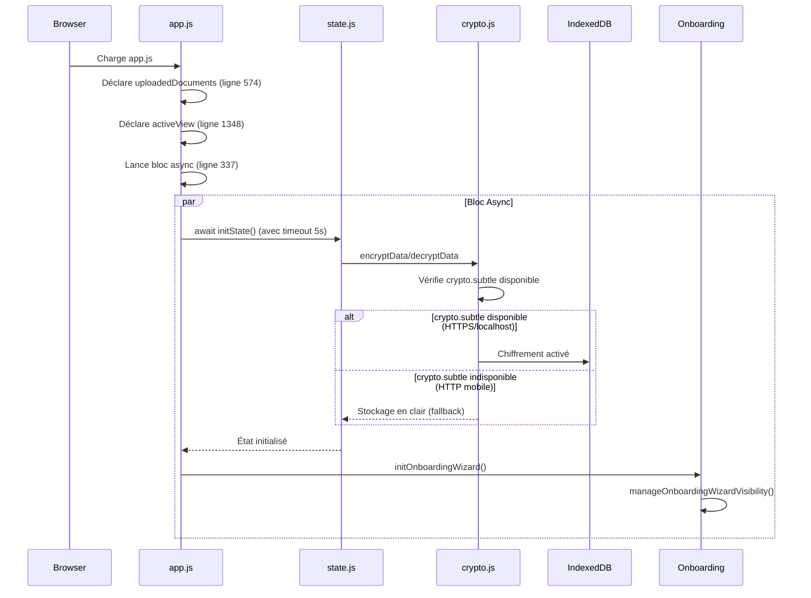

# Architecture de l'Onboarding - Documentation Critique

## ⚠️ ATTENTION : Zone Sensible
Cette fonctionnalité est **critique** pour l'expérience utilisateur. Toute régression empêche les nouveaux utilisateurs d'accéder à l'application.

**Dernière mise à jour** : 2025-11-01  
**Statut** : ✅ Fonctionnel (Desktop + Mobile)

---

## État de la refonte du lot E

L'accueil, la personnalisation facultative et le choix du parcours utilisent les styles communs `ui-card`, `ui-icon` et `ui-badge`, ainsi que les variables `--ui-*`. Les boutons et champs partagés ci-dessous sont utilisés dans l'onboarding et les parcours migrés. Les modales d'extrait, de choix des sources, de réglages des alertes, de détail photo, d'associations, de confirmation des suppressions, d'équipement, de membre, de gestion familiale, de saisie manuelle et l'ancien aperçu de scan utilisent le socle commun de dialogue. Les vues Accueil hors onboarding, Recherche, Assistant, Alertes, Vos données, Famille, Maison, détail équipement, Importer, Profil et Plus adoptent les composants partagés. Les confirmations du navigateur restent natives. Les titres de l'onboarding reçoivent le focus lors des transitions ; l'accessibilité complète reste à vérifier.

La palette bleu/marine et le logo officiel recadré de l'onboarding sont repris dans les vues migrées. La classe `body.ui-theme`, activée par `showView()` pour `accueil`, `recherche`, `assistant`, `alertes`, `vos-donnees`, `famille`, `maison`, `detail`, `importer`, `profil` et `plus`, puis retirée ailleurs, adapte aussi leur navigation sans recolorer les vues non migrées. Le fond commun utilise `--ui-page`. Les interactions et limites de validation sont décrites dans [la maquette UI](MAQUETTE_UI_MOBILE.md).

L'Accueil hors onboarding propose un raccourci vers Recherche, l'ajout via Importer et le rejeu de la démo via `startOnboardingReplay(3)`, sans modifier les données applicatives. Il ne contient plus de formulaire de recherche ni de bouton flottant. Son nom et ses compteurs sont réaffichés après initialisation persistante ; les compteurs utilisent le même inventaire que Vos données et identifient les exemples fictifs, absents de l'index personnel. La région porte le nom stable « Accueil ». Dans Recherche, les filtres restent associés au formulaire unique ; sources et propositions expérimentales sont des volets secondaires. La remise à zéro rend le focus au champ, sans changer l'index ni les règles de confirmation.

Les raccourcis `data-open-import` d'Accueil, Recherche et Vos données convergent vers Importer. Le contexte de retour reste en mémoire, sans persistance : route, paramètres et contrôle déclencheur. Le retour explicite restaure la route et le focus ; un import local depuis Recherche conserve sa question. Quitter Importer efface ce contexte. Les trois cartes appareil/Google/OneDrive reprennent les icônes existantes. `openSourceChoices(source)` limite le dialogue partagé aux options du fournisseur choisi ; consulter les permissions n'appelle ni connexion ni indexation. Les états des cartes sont issus de `updateGoogleDriveButton()` et `updateOneDriveActions()`. Les flux d'autorisation, de lecture et d'arrêt du dialogue sont inchangés.

Le profil est renseigné par `initProfileView()` quelle que soit la route d'entrée, puis réactualisé après chargement de l'état persistant. Le formulaire appelle les mécanismes de consentement existants, sans nouvelle permission. Les réglages de scan/connexion non reliés restent dans un aperçu désactivé. La saisie manuelle attend la sauvegarde avant d'actualiser la liste de documents de la vue ; en cas d'erreur, le dialogue conserve son contenu et un identifiant stable pour la nouvelle tentative. Fermer le dialogue le retire du DOM et restaure le focus, y compris avec Échap.

L'Assistant utilise toujours `rankDocuments()` et `buildSearchResponse()`, pas l'index photo unifié. `refreshAssistantContext()` distingue les documents fictifs de repli et les fichiers chargés à l'entrée de la vue, après initialisation persistante et à la soumission. Les réponses affichent leur statut, les preuves et deux sources au maximum ; une copie encore disponible s'ouvre dans le dialogue d'extrait partagé. Les messages ne sont pas stockés et disparaissent au rechargement. Les suggestions ne déclenchent plus une recherche cachée dans l'autre formulaire. La réponse locale n'a plus de délai artificiel ; une erreur conserve la saisie et est annoncée.

L'ancien `onboarding-scan-dialog` n'a aucun point d'entrée ni gestionnaire de scan dans l'application. Son contenu partagé est explicitement non opérationnel : champs désactivés, case non précochée et fermeture par formulaire `method="dialog"` ou Échap. Cette migration ne branche pas le scan, ne demande pas de permission et ne change ni les préférences persistées ni le traitement de fond existant.

### Premiers composants CSS partagés

- Bouton : `ui-button` avec une variante `ui-button--primary`, `ui-button--secondary` ou `ui-button--text` ; ajouter `ui-button--full` pour occuper la largeur disponible. Utiliser un vrai élément `button` et son attribut `disabled` si nécessaire.
- Action destructive : `ui-button--danger` utilise le jeton `--ui-danger`. Dans une confirmation, privilégier le focus initial sur « Annuler » et conserver les avertissements sur les originaux ; ce style n'implémente aucune suppression.
- Champ texte : `ui-input` sur l'élément `input` et `ui-label` sur un `label` associé par `for` et `id`. Le libellé reste nécessaire même en présence d'un placeholder.
- Cartes, icônes et badges : `ui-card`, `ui-icon` et `ui-badge`. Les classes propres à une vue restent responsables de leur disposition et de leurs dimensions particulières.
- Modale : utiliser un élément `dialog` avec `ui-dialog`, un titre identifié par `aria-labelledby`, un en-tête `ui-dialog__header` et un bouton de fermeture `ui-dialog__close` avec un libellé accessible. Ouvrir avec `showModal()` et fermer avec `close()` ; la classe CSS ne gère ni l'ouverture ni la fermeture par clic sur le fond. Le dialogue natif gère Échap et le retour du focus. Prévoir une description liée par `aria-describedby` lorsqu'elle est utile, sans y inclure un contenu long.

Ces classes sont facultatives et ne remplacent pas automatiquement les styles existants. Elles prévoient un focus clavier visible et une cible de bouton d'au moins 48 × 48 px ; les contrastes et l'accessibilité des vues complètes doivent encore être vérifiés. La migration des autres modales et les autres types de champs restent à réaliser.

Le parcours personnel existant ouvre le sélecteur de fichiers ou de dossier. La démo de l'onboarding affiche des résultats fictifs dans le wizard, sans appeler l'ancienne initialisation destructrice, sans importer de données et sans connecter de compte. Depuis le choix des sources, « Exemples de démonstration » ouvre directement cette même démo isolée ; il ne crée pas de copies fictives dans les données personnelles. Après la démo, « Terminer » marque l'onboarding terminé s'il ne l'était pas ; depuis le profil, « Revoir la découverte » le rouvre sans effacer les données ni la progression. Les descriptions historiques ci-dessous peuvent ne pas refléter le parcours actuel.

La démo inclut des scénarios fictifs de facture, de contrat d'habitation, de garantie et de photos, ainsi qu'un guide facultatif en trois étapes : choix d'une question, lecture de la source fictive, de la date et de l'extrait, puis rappel qu'une échéance ne devient une alerte qu'après confirmation et mise en évidence du bouton « Terminer ». L'échéance du contrat ne crée aucune alerte. Le choix d'une question avance automatiquement le guide de l'étape 1 à l'étape 2 ; les boutons permettent aussi d'avancer, de revenir, de le passer et de le revoir. Les exemples restent accessibles librement, sans superposition bloquante ni mouvement imposé. Le guide est temporaire et repart de la première étape à chaque nouvelle ouverture de la démo. Il ne constitue pas encore une visite des autres vues ni une recherche réelle.

Le wizard affiche sa progression (« Étape 1 sur 3 · Personnalisation », « Étape 2 sur 3 · Choix du parcours », « Étape 3 sur 3 · Démo avec exemples fictifs ») dans l'en-tête de chaque étape ; l'écran d'accueil n'est pas numéroté. Le focus est placé sur le titre de l'étape et la touche Entrée dans le champ du prénom (facultatif) équivaut à « Continuer ».

### Visite guidée des vues

Depuis le profil, « Visiter les autres vues » lance une visite non modale de Recherche, Maison, Famille, Alertes, Vos données et Importer. Une proposition facultative est également affichée dans la dernière étape de la démo ; la visite peut être quittée sans empêcher de terminer ou de reprendre le wizard.

Le panneau reste visible pendant la navigation, annonce la progression et propose précédent, suivant et quitter. Chaque étape passe par `showView()`, met le titre de la vue en évidence et, à la fin ou à la sortie, revient à la vue et au contrôle de lancement. Une navigation choisie par l'utilisateur ferme la visite sans détourner cette navigation.

La visite est en lecture seule : elle n'active pas les contrôles d'import, ne lance pas de connexion et ne demande pas de permission. Les vues restent les vues réelles de l'application et peuvent donc afficher les données locales déjà présentes ; ce point est annoncé avant et pendant le parcours. La recherche et les sources sont décrites avec leurs limites actuelles, sans promettre une couverture complète.

Les tests ciblés se trouvent dans `tests/view-tour.spec.js` : quatre largeurs de référence, progression clavier, précédent, retour au profil, rejeu, sortie, lancement depuis la démo, navigation manuelle, absence d'écriture IndexedDB et absence de requêtes externes supplémentaires. Les essais manuels sur appareils et les contrastes doivent encore être validés.

Pour les tests ciblés, démarrer Vite sur `127.0.0.1:5179`, puis lancer `npx playwright test onboarding-refresh --workers=1`. Les tests utilisent des profils navigateur isolés et des données fictives.

---

## 🏗️ Architecture Globale

### Flux de démarrage de l'application



---

## 🔑 Composants Critiques

### 1. Variables Globales (Ordre de Déclaration CRITIQUE)

**⚠️ NE JAMAIS appeler une fonction qui utilise ces variables AVANT leur déclaration**

| Variable | Ligne | Utilisée par | Déclaration |
|----------|-------|--------------|-------------|
| `uploadedDocuments` | 574 | `initOnboardingWizard()`, tous les rendus de vues | `const uploadedDocuments = []` |
| `activeView` | 1348 | `manageOnboardingWizardVisibility()`, navigation | `let activeView = (() => { ... })()` |
| `onboardingCompleteKey` | 569 | `isOnboardingComplete()`, `completeOnboarding()` | `const onboardingCompleteKey = "famili-ia-source-choice-complete"` |

**Règle d'or** : Le bloc async (ligne 337) appelle `initOnboardingWizard()` **UNIQUEMENT après `initState()` réussi**, garantissant que toutes les variables sont déclarées.

---

### 2. Fonction `initOnboardingWizard()` (Ligne 57)

**Responsabilités** :
- ✅ Initialiser les event listeners sur les boutons du wizard
- ✅ Gérer la navigation entre les 3 étapes (step-0, step-1, step-2)
- ✅ Valider les champs prénom/ville (étape 1→2)
- ✅ Gérer les actions finales : "Explorer la démo" / "Lancer le scan intelligent"
- ✅ Appeler `manageOnboardingWizardVisibility()` pour afficher/masquer le wizard

**Dépendances** :
- `activeView` (ligne 1348) → utilisé dans `manageOnboardingWizardVisibility()`
- `isOnboardingComplete()` (ligne 17) → contrôle si le wizard doit s'afficher
- `getCurrentUser()` (state.js) → lecture/écriture du profil utilisateur

**Points d'attention** :
- ❌ **NE JAMAIS** appeler cette fonction avant la ligne 1348 (déclaration `activeView`)
- ❌ **NE JAMAIS** appeler `manageOnboardingWizardVisibility()` de façon synchrone au chargement si `activeView` n'est pas encore défini
- ✅ **TOUJOURS** vérifier `isOnboardingComplete()` avant d'attacher les listeners

---

### 3. Fonction `manageOnboardingWizardVisibility()` (Ligne 31)

**Logique de visibilité** :
```javascript
const shouldShow = show || (!onboardingComplete && activeView === 'accueil');
wizard.hidden = !shouldShow;
```

**Le wizard s'affiche SI ET SEULEMENT SI** :
1. ✅ `isOnboardingComplete() === false` (localStorage vide ou !== "true")
2. ✅ `activeView === 'accueil'` (pas sur une autre vue)
3. ✅ OU `show === true` (force l'affichage, utilisé par le retour après démo)

**Cas d'usage** :
- Premier lancement → `firstRun=true`, `activeView='accueil'` → **Wizard affiché**
- Retour après démo (Phase 13.2.c.6) → `show=true` → **Wizard réaffiché**
- Navigation vers autre vue → `activeView !== 'accueil'` → **Wizard masqué**
- Onboarding complété → `isOnboardingComplete()=true` → **Wizard masqué définitivement**

---

### 4. Bloc d'Initialisation Asynchrone (Ligne 337)

**Architecture actuelle (CORRIGÉE pour mobile)** :

```javascript
(async () => {
  console.log('[DEBUG] Async init - START');
  try {
    // === TIMEOUT CRITIQUE (5 secondes) ===
    // Sur mobile HTTP, crypto.subtle bloque → le timeout évite le freeze infini
    const initStatePromise = initState();
    const timeoutPromise = new Promise((_, reject) => 
      setTimeout(() => reject(new Error('initState() timeout after 5s')), 5000)
    );
    
    const stateResult = await Promise.race([initStatePromise, timeoutPromise]);
    
    // === ORDRE CRITIQUE ===
    uploadedDocuments.push(...getDocuments());  // ← uploadedDocuments DOIT exister
    initEquipmentDialog();
    initAddMemberDialog();
    
    // === ONBOARDING INIT ===
    initOnboardingWizard();  // ← Appelé ICI, après déclaration de toutes les variables
    
    updateDemoModeUI();
    updateSuggestionsUI();
    
  } catch (error) {
    console.error('[DEBUG] Async init - ERROR:', error);
    // === FALLBACK CRITIQUE ===
    // Même si initState() échoue, on initialise quand même l'onboarding
    try {
      initOnboardingWizard();
    } catch (e2) {
      console.error('[DEBUG] Async init - Fallback onboarding init FAILED:', e2);
    }
  }
})();
```

**Pourquoi ce timeout est CRITIQUE** :
- Sur mobile en HTTP (IP locale 192.168.x.x), `crypto.subtle` est `undefined`
- `initState()` appelle `crypto.js` → `getMasterKey()` → `crypto.subtle.generateKey()`
- Sans le timeout, l'app **gèle indéfiniment** sur mobile
- Avec le timeout, le fallback se déclenche et l'onboarding s'affiche quand même

---

## 🚨 Problèmes Résolus (Historique des Régressions)

### Régression #1 : Race Condition `activeView` (2025-11-01)
**Symptôme** : L'onboarding ne s'affiche pas sur mobile, mais fonctionne sur desktop.

**Cause racine** : 
- `activeView` était initialisé à `"accueil"` (hardcodé ligne 1310)
- Sur mobile, le timing d'exécution était différent
- `manageOnboardingWizardVisibility()` était appelé **avant** que `showView()` mette à jour `activeView`
- Résultat : `shouldShow = false` → wizard masqué

**Correction appliquée** :
```javascript
// AVANT (bugué)
let activeView = "accueil";

// APRÈS (corrigé)
let activeView = (() => {
  const hash = window.location.hash.substring(1);
  if (!hash || hash === '' || hash === '#') return 'accueil';
  const viewMatch = hash.match(/^\/?([^?]+)/);
  return viewMatch ? viewMatch[1] : 'accueil';
})();
```

**Validation** : `activeView` est maintenant initialisé **dès le départ** en parsant le hash, éliminant la race condition.

---

### Régression #2 : Blocage `initState()` sur Mobile HTTP (2025-11-01)
**Symptôme** : La console affiche `[DEBUG] Async init - START` puis plus rien. L'app gèle.

**Cause racine** :
- `crypto.js` utilise `crypto.subtle.generateKey()` (ligne 30)
- `crypto.subtle` est `undefined` en HTTP sur mobile (sécurité navigateur)
- `await initState()` ne se termine **jamais** → freeze infini

**Correction appliquée** :
1. **Timeout sur `initState()`** : `Promise.race()` avec timeout de 5 secondes
2. **Fallback dans `crypto.js`** :
```javascript
const isCryptoAvailable = typeof crypto !== 'undefined' && 
                          typeof crypto.subtle !== 'undefined' &&
                          crypto.subtle !== null;

export async function encryptData(data) {
  if (!isCryptoAvailable) {
    console.warn('[CRYPTO] Encryption skipped - crypto.subtle not available');
    return data; // Stockage en clair
  }
  // ... chiffrement normal
}
```

**Validation** : 
- En HTTPS/localhost → chiffrement activé
- En HTTP mobile → stockage en clair, pas de blocage

---

### Régression #3 : Erreur Hoisting Variables (2025-11-01)
**Symptôme** : `ReferenceError: Cannot access 'activeView' before initialization`

**Cause racine** :
- Tentative d'appel à `initOnboardingWizard()` **avant** le bloc async
- `activeView` (ligne 1348) n'était pas encore déclaré
- JavaScript refuse l'accès avant la déclaration (`let`/`const`)

**Correction appliquée** :
- Suppression du bloc d'initialisation synchrone
- Appel à `initOnboardingWizard()` **uniquement** dans le bloc async, après `initState()`

**Validation** : Plus d'erreur de hoisting, l'ordre de déclaration est respecté.

---

## 📐 Styles CSS Mobile (Phase Correction Mobile)

### Z-index et Positionnement
```css
.onboarding-page-white {
  position: fixed;
  z-index: 2000; /* CRITIQUE : au-dessus de topbar (z-index: 100) et bottom-nav */
  touch-action: manipulation; /* Améliore la réactivité tactile */
  overflow-y: auto; /* Scroll sur petits écrans */
  -webkit-overflow-scrolling: touch; /* Smooth scroll iOS */
}
```

**Pourquoi z-index: 2000 ?**
- `topbar` : z-index 100
- `bottom-nav` : z-index variable
- Onboarding DOIT recouvrir toute l'interface → z-index élevé nécessaire

### Media Query Mobile (max-width: 600px)
```css
@media (max-width: 600px) {
  .onboarding-page-white {
    padding: 1rem; /* Réduit de 2rem */
    justify-content: flex-start; /* Alignement haut au lieu de centré */
    padding-top: 10vh; /* Espace en haut */
  }
  
  .onboarding-page-white .wizard-step .primary-button,
  .onboarding-page-white .wizard-step .secondary-button {
    min-height: 44px; /* Taille minimale tactile (Apple HIG) */
    -webkit-tap-highlight-color: rgba(0, 0, 0, 0.1); /* Feedback visuel iOS */
    user-select: none; /* Évite sélection texte au tap */
  }
}
```

---

## ✅ Checklist Avant Modification de l'Onboarding

Avant de toucher à cette zone, **VÉRIFIER** :

### Code JavaScript
- [ ] **Ordre de déclaration** : `uploadedDocuments` (574) et `activeView` (1348) déclarés AVANT utilisation
- [ ] **Bloc async** : `initOnboardingWizard()` appelé APRÈS `await initState()`
- [ ] **Fallback** : Le `catch` du bloc async appelle bien `initOnboardingWizard()` en cas d'erreur
- [ ] **Timeout** : `Promise.race()` sur `initState()` maintenu (5 secondes)
- [ ] **Logs debug** : Les logs `[DEBUG]` sont présents pour tracer le flux d'initialisation

### Gestion de l'État
- [ ] **localStorage** : La clé `onboardingCompleteKey` est bien lue/écrite
- [ ] **activeView** : Initialisé en parsant `window.location.hash` dès le départ
- [ ] **isOnboardingComplete()** : Retourne `localStorage.getItem(onboardingCompleteKey) === "true"`
- [ ] **completeOnboarding()** : Écrit `localStorage.setItem(onboardingCompleteKey, "true")`

### Styles CSS
- [ ] **z-index** : `.onboarding-page-white { z-index: 2000; }` maintenu
- [ ] **Touch handling** : `touch-action: manipulation` + `min-height: 44px` sur les boutons
- [ ] **Media query** : `@media (max-width: 600px)` présente et fonctionnelle
- [ ] **Viewport** : Pas de `overflow: hidden` sur `body` qui bloquerait le scroll

### HTML Structure
- [ ] **Attribut `hidden`** : Le wizard utilise `<section hidden>` (pas `display: none` inline)
- [ ] **data-attributes** : `data-wizard-next` et `data-wizard-prev` présents sur les boutons
- [ ] **IDs uniques** : `#onboarding-wizard`, `#step-0`, `#step-1`, `#step-2` existent
- [ ] **Inputs** : `#wizard-user-name` et `#wizard-user-city` présents à l'étape 1

---

## 🧪 Tests de Non-Régression

### Test Manuel Mobile (CRITIQUE)
1. **Environnement** : Smartphone réel connecté en HTTP (192.168.x.x:5179)
2. **Vider localStorage** : Ouvrir DevTools mobile → Application → Local Storage → Supprimer `famili-ia-source-choice-complete`
3. **Recharger la page**
4. **Vérifier la console** :
   ```
   [CRYPTO] crypto.subtle available: false
   [DEBUG] Async init - START
   [DEBUG] initOnboardingWizard - START
   [DEBUG] manageOnboardingWizardVisibility: { shouldShow: true }
   ```
5. **Vérifier l'affichage** : Le wizard doit apparaître en plein écran
6. **Tester les boutons** :
   - Étape 0 : Clic sur "Continuer" → passe à l'étape 1
   - Étape 1 : Saisir prénom/ville → Clic "Continuer" → passe à l'étape 2
   - Étape 2 : Clic "Explorer la démo" → lance la visite guidée
7. **Vérifier localStorage** : Après la démo, `famili-ia-source-choice-complete` doit être `"true"`

### Test Desktop (Chrome DevTools Mobile Emulation)
1. F12 → Toggle Device Toolbar
2. Sélectionner "iPhone 12 Pro"
3. Répéter les étapes ci-dessus

### Test de Régression Automatisable (Futur)
```javascript
// Pseudo-code pour test Playwright/Cypress
test('Onboarding s\'affiche au premier lancement', async () => {
  await page.goto('http://localhost:5179');
  await page.evaluate(() => localStorage.clear());
  await page.reload();
  
  // Le wizard doit être visible
  const wizard = await page.locator('#onboarding-wizard');
  await expect(wizard).not.toHaveAttribute('hidden');
  
  // Étape 0 visible
  const step0 = await page.locator('#step-0');
  await expect(step0).not.toHaveAttribute('hidden');
});
```

---

## 📚 Fichiers à Consulter

| Fichier | Rôle | Lignes critiques |
|---------|------|------------------|
| `app.js` | Orchestration onboarding | 17-81 (fonctions), 337-392 (bloc async), 574 (uploadedDocuments), 1348 (activeView) |
| `state.js` | Gestion état utilisateur | 59-94 (initState) |
| `crypto.js` | Chiffrement données | 10-44 (getMasterKey), 57-81 (encrypt/decrypt) |
| `index.html` | Structure HTML wizard | 72-101 (section #onboarding-wizard) |
| `styles.css` | Styles onboarding | 1273-1366 (`.onboarding-page-white`) |
| `CLAUDE.md` | Charte projet | Checklist anti-régression |

---

## 🔗 Références Externes

- **Web Crypto API** : https://developer.mozilla.org/en-US/docs/Web/API/Web_Crypto_API
- **localStorage** : https://developer.mozilla.org/en-US/docs/Web/API/Window/localStorage
- **Touch Events** : https://developer.mozilla.org/en-US/docs/Web/API/Touch_events
- **Apple HIG - Touch Targets** : https://developer.apple.com/design/human-interface-guidelines/ios/visual-design/adaptivity-and-layout/

---

## 📝 Notes de Version

### v1.0 - 2025-11-01
- ✅ Correction race condition `activeView`
- ✅ Ajout timeout `initState()` (5s)
- ✅ Fallback crypto.subtle indisponible (HTTP mobile)
- ✅ Amélioration styles CSS mobile (z-index, touch-action)
- ✅ Documentation architecture complète

### Prochaines Améliorations
- [ ] Tests automatisés Playwright
- [ ] Telemetry onboarding (taux de complétion, points de sortie)
- [ ] A/B testing textes onboarding
- [ ] Mode "skip" pour développeurs (variable d'environnement)
