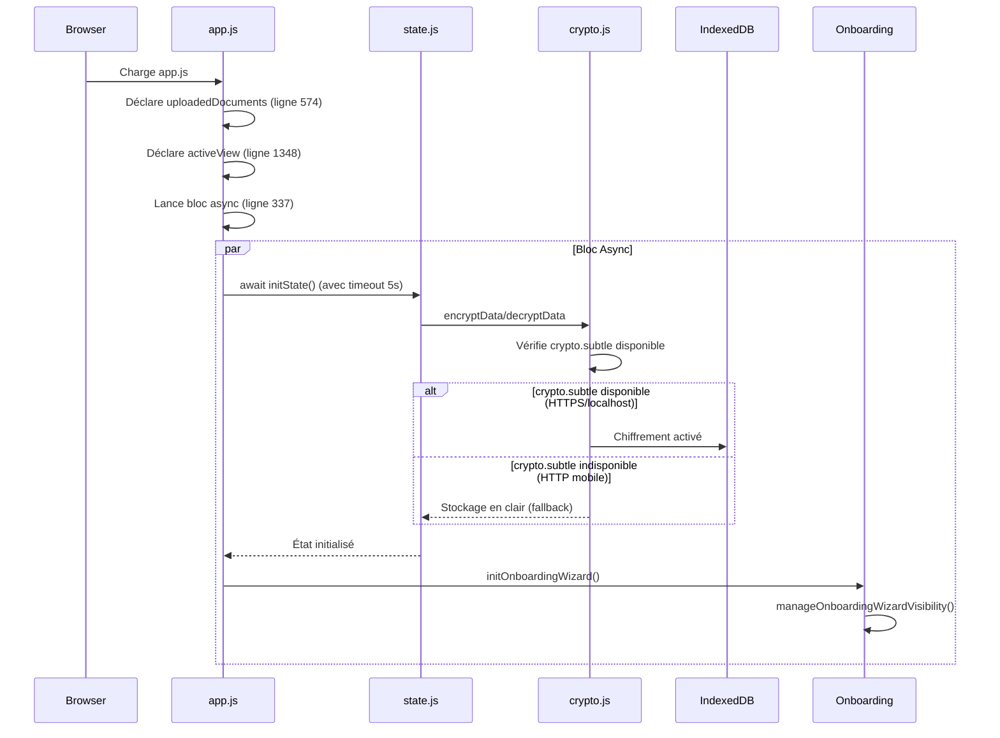

# Architecture de l'Onboarding - Documentation Critique

## ⚠️ ATTENTION : Zone Sensible
Cette fonctionnalité est **critique** pour l'expérience utilisateur. Toute régression empêche les nouveaux utilisateurs d'accéder à l'application.

**Dernière mise à jour** : 2025-11-01  
**Statut** : ✅ Fonctionnel (Desktop + Mobile)

---

## Premier lancement actuel · Prisme Aurore

Après initialisation du stockage local, `initOnboardingWizard()` relie le dialogue natif à [onboarding.js](../onboarding.js). Au premier passage sur Accueil : bienvenue → prénom facultatif → choix du parcours. Le parcours personnel continue par les intentions de sources et le récapitulatif ; la démo enchaîne question fictive, preuve et simulation de rappel. « Passer » quitte sans valider le brouillon. Seule la confirmation du parcours personnel enregistre le prénom via le mécanisme de profil existant. Les sources ne sont ni connectées ni importées.

« Revoir la démo » ouvre directement les trois étapes fictives ; « Revoir la découverte » rejoue le parcours complet sans modifier le profil. La sortie restaure la vue d’origine. La visite détaillée existante reste accessible à la fin de la démo. L’indicateur de premier lancement existant est conservé.

## Historique · refonte du lot E et architecture antérieure

L'accueil, la personnalisation facultative et le choix du parcours utilisent les styles communs `ui-card`, `ui-icon` et `ui-badge`, ainsi que les variables `--ui-*`. Les boutons et champs partagés ci-dessous sont utilisés dans l'onboarding et les parcours migrés. Les modales d'extrait, de choix des sources, de réglages des alertes, de détail photo, d'associations, de confirmation des suppressions, d'équipement, de membre, de gestion familiale, de saisie manuelle et l'ancien aperçu de scan utilisent le socle commun de dialogue. Les vues Accueil hors onboarding, Recherche, Assistant, Alertes, Vos données, Famille, Maison, détail équipement, Importer, Profil et Plus adoptent les composants partagés. Les confirmations du navigateur restent natives. Les titres de l'onboarding reçoivent le focus lors des transitions ; l'accessibilité complète reste à vérifier.

La palette bleu/marine et le logo officiel recadré de l'onboarding sont repris dans les vues migrées. La classe `body.ui-theme`, activée par `showView()` pour `accueil`, `recherche`, `assistant`, `alertes`, `vos-donnees`, `famille`, `maison`, `detail`, `importer`, `profil` et `plus`, puis retirée ailleurs, adapte aussi leur navigation sans recolorer les vues non migrées. Le fond commun utilise `--ui-page`. Les interactions et limites de validation sont décrites dans [la maquette UI](MAQUETTE_UI_MOBILE.md).

**Harmonisation chaleureuse du lot D :** `showView()` ajoute `body.ui-warm` pour Accueil, Recherche, Maison, détail équipement, Importer, Alertes, Famille, Vos données, Profil, Plus et Assistant et la retire sur les autres routes. Combinée à `ui-theme`, elle décline les fonds ivoire, surfaces crème, titres foncés et accents ambrés de la démo, sans modifier les couleurs des actions principales ni les états sémantiques. Les composants partagés utilisent `--ui-surface`, `--ui-card-radius` et `--ui-focus` ; leurs valeurs par défaut préservent les vues restantes. Le thème ne crée aucune préférence persistante ni permission.

L'Accueil hors onboarding propose un raccourci vers Recherche, l'ajout via Importer et le rejeu de la démo via `startOnboardingReplay(3)`, sans modifier les données applicatives. Il ne contient plus de formulaire de recherche ni de bouton flottant. Son nom et ses compteurs sont réaffichés après initialisation persistante ; les compteurs utilisent le même inventaire que Vos données et identifient les exemples fictifs, absents de l'index personnel. La région porte le nom stable « Accueil ». Dans Recherche, les filtres restent associés au formulaire unique ; sources et propositions expérimentales sont des volets secondaires. La remise à zéro rend le focus au champ, sans changer l'index ni les règles de confirmation.

L'Accueil privilégie l'introduction et les raccourcis, puis les rappels, le foyer, les compteurs secondaires et l'invitation à la démo. Le profil par défaut « Mon espace » reçoit « Bienvenue chez vous » ; un nom personnel est inséré via `textContent`, sans modifier le profil. L'illustration SVG est décorative (`aria-hidden`) et masquée sur smartphone. Le filtrage des rappels actifs et leurs destinations sont conservés ; l'état vide rappelle que seules les alertes enregistrées apparaissent, sans garantir une couverture des échéances.

### Accompagnement à la demande

Les blocs systématiques « Quelques repères » ont été retirés après retour utilisateur : ils augmentaient le défilement sur smartphone. Aucun volet, icône ou infobulle permanente ne les remplace. L'accompagnement repose sur les libellés existants, les états vides avec action directe, les erreurs et les confirmations au moment utile. Permissions, provenance et portée des suppressions restent à leur point d'interaction.

Le module, les styles et les appels de mémorisation des repères sont supprimés ; une ancienne préférence éventuelle n'est plus lue ni écrite. La découverte et la visite des vues restent rejouables explicitement depuis Profil. `openImportFrom()` conserve le contexte et le focus de retour ; `showView()` garde son défilement immédiat lorsque le mouvement réduit est activé. Le retrait n'affecte ni les stores métier, ni les permissions, ni les confirmations de suppression. Les appareils physiques et lecteurs d'écran restent à valider séparément.

### Parcours des vues

Recherche réutilise le moteur et les correspondances existants : `describeExperimentalResult()` fournit les libellés de source et de couverture, les détails et les raisons complètes. Le rendu met en avant la première raison de contenu disponible, sinon le premier indice, sans confondre nom ou métadonnée avec un extrait documentaire. La valeur est insérée dans un `mark` par `textContent` ; les approximations et estimations restent signalées. Les détails et toutes les raisons sont conservés dans un `details` natif, sans déplacer l'action d'ouverture de copie à l'intérieur. Les photos réutilisent les vignettes locales et leur chargement différé existant ; seuls leur disposition et le rangement des métadonnées dans un volet changent. Pagination, sélection, correction, confirmation de suppression et vérification OneDrive sont préservées.

Maison et les fiches partagent `getEquipmentIllustration()` pour les visuels de catégorie, toujours signalés comme illustrations. La fiche lit les identifiants `docs` existants, privilégie la copie chargée sur les exemples de repli de même identifiant et conserve un message explicite si une copie manque. Les rappels proviennent uniquement de `getAlerts()`, avec statut actif ou absent et `docId` référencé par la fiche ; aucune échéance n'est déduite du nom, du statut ou d'un document. Les helpers de date existants normalisent l'affichage et orientent vers le filtre Alertes correspondant, y compris les reports. Les preuves sont échappées, les états de source à vérifier restent visibles et les liens ne créent aucune association. Une route de détail sans identifiant passe aussi par l'état « Équipement non trouvé », sans afficher la fiche précédente.

Les couvertures des équipements conservent leurs illustrations IA par défaut et après retrait, ou un repère de catégorie lorsqu'aucune illustration n'existe ; la maison n'a plus de photo personnalisable (illustration IA standard). `initCoverPhotoDialog()` ne sert plus qu'aux équipements (identifiants historiques `house-photo-*` conservés). Il garde un brouillon local sans modifier les vues ni le stockage avant confirmation. `cover-photo.js`, extrait du traitement Maison, réutilise le décodage orienté et l'encodage de `photo-thumbnails.js` pour une copie JPEG bornée à 1 280 px et 256 Kio, sans métadonnées d'origine ni champs supplémentaires conservés. Les positions 0–100 sont appliquées avec `object-position` ; l'aperçu reprend le ratio de l'image à l'ouverture, les cadres des équipements gardent une hauteur indépendante du fichier choisi. `updateEquipmentPhoto(photo, expectedEquipment, expectedUser)` publie seulement après persistance. Ajout, modification, suppression d'équipement et purge partagent la file de mutations photo ; un brouillon antérieur au remplacement du profil, à la modification ou à la suppression de sa fiche est refusé dans cette session, sans garantie multi-onglets. Une modification des informations conserve la couverture courante. Fermeture pendant préparation : résultat tardif ignoré ; pendant persistance : fermeture suspendue jusqu'au résultat. Une copie invalide ou illisible est signalée avec retour visuel explicite au visuel par défaut, sans effacement silencieux. Les copies `equipment.coverPhoto` suivent export JSON et purge, pas le rapport PDF ; un `currentUser.housePhoto` déjà enregistré est conservé dans l'export/la purge mais n'est plus affiché. Supprimer une fiche retire sa copie uniquement. Aucun document, index, analyse ou permission cloud n'est créé ; toute analyse future exige un choix séparé.

Les raccourcis `data-open-import` d'Accueil, Recherche, Vos données et Profil convergent vers Importer. Le contexte de retour reste en mémoire, sans persistance : route, paramètres et contrôle déclencheur. Le retour explicite restaure la route et le focus ; un import local depuis Recherche conserve sa question. Quitter Importer efface ce contexte. Les quatre cartes appareil/Google/OneDrive/Dropbox reprennent les icônes existantes. `openSourceChoices(source)` limite le dialogue partagé aux options du fournisseur choisi ; consulter les permissions n'appelle ni connexion ni indexation. Les états des cartes sont issus de `updateGoogleDriveButton()`, `updateOneDriveActions()` et `updateDropboxActions()`. Les flux d'autorisation, de lecture et d'arrêt du dialogue sont inchangés.

Importer présente trois repères statiques, pas un assistant bloquant. `updateScanProgressUI()` alimente également le suivi intégré avec les événements du worker existant, sans changer ses tâches ni sa cadence. Le `progress` natif reste indéterminé pendant l'exploration, puis utilise `processed` et `total` : il ne mesure pas un taux de réussite. `setImportFeedback()` affiche les messages par `textContent` ; les refus de sélection et les erreurs critiques restent visibles, les avertissements sont distingués d'un succès complet. La saisie manuelle confirme uniquement sa sauvegarde effective, sans barre de traitement. Ce dernier état local reste dans le DOM pendant les navigations, sans stockage supplémentaire ni cumul d'ajouts simultanés ; le rechargement le réinitialise. Le toast global et l'ouverture de Recherche après sélection locale restent inchangés. Le suivi cloud n'est pas agrégé à ce bilan : il demeure dans les options existantes de chaque fournisseur.

Dans Alertes, `renderAlerts()` conserve les cinq filtres et trie uniquement une liste dérivée des alertes : échéance normalisée croissante, ou reprise pour les reports, avec les dates inconnues à la fin. Il réutilise `normalizeAlertDate()` et `getDaysUntilDate()` ; ni les seuils, ni les dates persistées, ni le moteur de notification ne changent. La liste ordonnée porte le titre de la catégorie ; chaque carte a un titre, un repère relatif lorsqu'il est calculable et un `time` valide. L'extrait est échappé avant insertion dans `mark`. Les avertissements de source restent entièrement visibles avec leur suspension des notifications. Le bouton d'ouverture est nommé selon la présence effective d'une copie et sa destination conserve les mécanismes existants ; les états vides réutilisent la navigation déléguée. Reports, correction, confirmations et lecture temporaire ne sont pas remplacés par des états de présentation.

Dans Famille, `renderFamilyMembers()` présente les membres enregistrés dans une liste nommée, sans exposer `role` ou `access`. Les avatars restent du texte échappé, jamais des URL d'images ; l'initiale de repli utilise le premier point de code du nom. `openMemberForm()` est partagé par l'ajout direct du cercle vide et le gestionnaire. À l'édition, le membre existant est conservé par décomposition puis seuls nom, date facultative et éventuelle initiale automatique sont actualisés ; un avatar personnalisé et les autres métadonnées sont préservés. La création garde les valeurs internes historiques `Member`/`limited`, sans prétendre appliquer des droits. Le formulaire attend la sauvegarde, signale les erreurs et conserve la saisie ; le focus revient à un contrôle présent après rerendu. La suppression réutilise `deleteFamilyMember()` et son nettoyage sérialisé des associations photo. La carte souvenirs remplace le faux Mode urgence par une explication de l'annotation manuelle et une navigation vers Recherche ; aucun compte, partage ou consentement n'est ajouté.

Dans Vos données, `renderDataInventory()` conserve le périmètre des fichiers enregistrés et des exemples de repli, les filtres et les actions photo. Le panneau de confiance distingue leurs nombres ; les cinq origines sont détaillées dans un `details` natif. `getSourceStatuses()` centralise les observations déjà utilisées par Recherche ; `renderInventorySourceStatus()` réutilise `describeSources()` et les parcours restaurés, sans requête fournisseur ni nouveau stockage. Il affiche le parcours connu le plus récent parmi les sources décrites, sans le présenter comme une vérification globale ou actuelle des originaux. Les dates d'import et de modification ne servent pas à inventer un contrôle. Les erreurs de persistance des parcours restent visibles ; leurs mises à jour actualisent aussi la vue active sans reconstruire la liste des fichiers. Le titre invisible des filtres a un panneau positionné comme repère pour ne pas étendre le document.

L'espace d'export et de suppression est distinct, sous l'inventaire. Le JSON conserve ses mécanismes et exclusions existants. Sur accord utilisateur, le générateur PDF invalide a été remplacé par `pdf-lib`, importé uniquement à la demande ; il écrit une vraie page avec polices standard et texte extractible. Le bilan ne lit que les nombres de documents par origine, de membres, d'équipements et de rappels ; aucun nom personnel, vignette, contenu ou GPS n'y est dessiné. Son périmètre limité et la différence avec le JSON sont explicites. La génération asynchrone désactive son bouton, signale les erreurs et autorise une nouvelle tentative, sans écrire dans l'état. Les confirmations, arrêts de scans et suppressions locales réutilisent intégralement les mécanismes existants ; les originaux, y compris Dropbox, restent inchangés.

Le profil est renseigné par `initProfileView()` quelle que soit la route d'entrée, puis réactualisé après chargement de l'état persistant. L'adresse facultative est dans un `details` natif, sans lien avec le GPS photo. Les anciens contrôles de télémétrie/partage et l'aperçu de scan/connexion sont retirés du profil, sans effacer leurs valeurs persistées. `getNameInitial()` est partagé avec Famille ; seuls les avatars automatiques sont actualisés au renommage. `updateUserProfile()` sérialise la sauvegarde avec les mutations photo, conserve les autres champs utilisateur et réutilise le retrait GPS existant. Un consentement actif inchangé ne renouvelle pas sa date. `updatePrivacyConsent()` et la sauvegarde d'identité publient leur nouvel objet en mémoire uniquement après `put`. L'ensemble purge/consentement/identité n'est toutefois pas une transaction globale : en cas d'échec ultérieur, la saisie est conservée, le choix GPS est resynchronisé et l'irréversibilité des coordonnées déjà effacées est annoncée. Aucun original n'est modifié. Les raccourcis Données/Importer/Alertes et l'aide restent réels ; le bouton d'en-tête réutilise `data-open-view`. Plus regroupe ses cinq destinations sans changer compteurs, routage ou persistance.

La saisie manuelle attend la sauvegarde avant d'actualiser la liste de documents de la vue ; en cas d'erreur, le dialogue conserve son contenu et un identifiant stable pour la nouvelle tentative. Fermer le dialogue le retire du DOM et restaure le focus, y compris avec Échap.

L'Assistant personnel utilise `prepareAssistantContext()` avec l'instance `IndexSession` de Recherche et `buildSearchResponse()` pour la réponse locale déterministe. Le module synchronise l'instantané complet, prépare les mots du sujet et variantes locales puis sélectionne les faits dans les seuls segments vérifiés. L'exploration photo reste dans Recherche ; seul un texte OCR déjà extrait et vérifié peut être lu, sans nouvelle analyse d'image. `rankDocuments()` est limité au repli fictif sans fichier chargé. `refreshAssistantContext()` annonce le périmètre à l'entrée de la vue, après initialisation et à la soumission. Le sujet recherché et l'indépendance des filtres sont visibles : aucune question, aucun filtre ni résultat de Recherche n'est modifié. Les réponses montrent leur statut, la couverture et deux sources au maximum ; une contradiction présente deux faits différents. La copie est contrôlée par triplet source/compte/élément, contenu et provenance avant ouverture. Les réponses dérivées sont invalidées lorsque la révision du corpus change ou qu'une copie n'est plus conforme, y compris avant le rechargement d'une purge. Les messages ne sont pas stockés et disparaissent au rechargement. Aucun délai simulé ; une erreur conserve la saisie et est annoncée.

L'harmonisation chaleureuse reste inchangée par A1. `addAIMessage()` utilise le fait exact en réponse courte uniquement lorsque le statut est `supported` ; les autres réponses conservent leurs explications et incertitudes. Le passage vient ensuite dans un `blockquote`/`mark` alimenté par `textContent`, avant nom et provenance. L'absence de passage, le texte non vérifié et l'absence de texte sont distingués ; aucun surlignage n'est fabriqué. Le formulaire précède les échanges, qui utilisent le défilement principal ; la nouvelle réponse est mise en vue et « Poser une autre question » rend le focus au champ. `getNameInitial()` est réutilisé pour l'avatar texte utilisateur. Le volet « Assistant ou Recherche ? » rappelle les questions indépendantes, l'absence d'IA distante et de synthèse multi-documents. A1 et les actions locales A4 de [l'Assistant enrichi](architecture/assistant-enrichi.md) sont livrés ; compréhension générative, contexte et suivi restent à réaliser. Aucun modèle ni mécanisme payant n'est présent ici.

A4 ajoute, pour une source unique non ambiguë, une proposition d'échéance admissible avec preuve distincte et date écrite ou estimée. `addDeadlineAlertAction()` est commun à Recherche et Assistant : confirmation native explicite, annulation sans écriture, état d'erreur visible et bouton protégé pendant l'enregistrement. Le service revalide la copie et enregistre document/alerte atomiquement ; un changement de révision retire les anciennes preuves et actions. Les exemples fictifs restent sans création d'alerte.

L'ancien `onboarding-scan-dialog` n'a aucun point d'entrée ni gestionnaire de scan dans l'application. Son contenu partagé est explicitement non opérationnel : champs désactivés, case non précochée et fermeture par formulaire `method="dialog"` ou Échap. Cette migration ne branche pas le scan, ne demande pas de permission et ne change ni les préférences persistées ni le traitement de fond existant.

### Premiers composants CSS partagés

- Bouton : `ui-button` avec une variante `ui-button--primary`, `ui-button--secondary` ou `ui-button--text` ; ajouter `ui-button--full` pour occuper la largeur disponible. Utiliser un vrai élément `button` et son attribut `disabled` si nécessaire.
- Action destructive : `ui-button--danger` utilise le jeton `--ui-danger`. Dans une confirmation, privilégier le focus initial sur « Annuler » et conserver les avertissements sur les originaux ; ce style n'implémente aucune suppression.
- Champ texte : `ui-input` sur l'élément `input` et `ui-label` sur un `label` associé par `for` et `id`. Le libellé reste nécessaire même en présence d'un placeholder.
- Cartes, icônes et badges : `ui-card`, `ui-icon` et `ui-badge`. Les classes propres à une vue restent responsables de leur disposition et de leurs dimensions particulières.
- Modale : utiliser un élément `dialog` avec `ui-dialog`, un titre identifié par `aria-labelledby`, un en-tête `ui-dialog__header` et un bouton de fermeture `ui-dialog__close` avec un libellé accessible. Ouvrir avec `showModal()` et fermer avec `close()` ; la classe CSS ne gère ni l'ouverture ni la fermeture par clic sur le fond. Le dialogue natif gère Échap et le retour du focus. Prévoir une description liée par `aria-describedby` lorsqu'elle est utile, sans y inclure un contenu long.

Ces classes sont facultatives et ne remplacent pas automatiquement les styles existants. Elles prévoient un focus clavier visible et une cible de bouton d'au moins 48 × 48 px ; les contrastes et l'accessibilité des vues complètes doivent encore être vérifiés. La migration des autres modales et les autres types de champs restent à réaliser.

Le parcours personnel existant ouvre le sélecteur de fichiers ou de dossier. La démo de l'onboarding affiche des résultats fictifs dans le wizard, sans appeler l'ancienne initialisation destructrice, sans importer de données et sans connecter de compte. Depuis le choix des sources, « Exemples de démonstration » ouvre directement cette même démo isolée ; il ne crée pas de copies fictives dans les données personnelles. Après la démo, « Terminer » marque l'onboarding terminé s'il ne l'était pas ; depuis le profil, « Revoir la découverte » le rouvre sans effacer les données ni la progression. Les descriptions historiques ci-dessous peuvent ne pas refléter le parcours actuel.

### Démo scénarisée isolée

L'étape de démo commence par un accueil illustré et deux choix explicites : suivre le guide ou explorer librement. Une seule mention globale précise que le foyer, les fichiers et les comptes sont préparés, sans connexion ni écriture réelle. Le récit met en scène Camille et Alex, leur maison et des souvenirs d'été ; il remplace la répétition de « fictif » sur chaque carte par une progression plus naturelle.

Le guide comporte six étapes : saisie animée d'une question, lecture de la preuve et de sa provenance, aperçu d'un rappel, regroupement des documents de la maison, souvenirs illustrés avec annotations, puis récapitulatif des cinq résultats et de leurs sources. Ce sont des **aperçus simplifiés à l'intérieur du wizard**, pas les vues personnelles ni une recherche réelle. « Explorer librement » permet de choisir une question et de parcourir les aperçus sans suivre le guide.

`DEMO_EXAMPLES` dans `app.js` fournit la facture de piscine, le contrat habitation, la garantie de pompe et deux souvenirs annotés autour de Camille, Alex et Léa. Les libellés de fournisseurs sont illustratifs : aucun compte n'est connecté. `createResultElement()` reprend les mêmes résultats dans Recherche, Photos et Vos données ; Maison réutilise les titres et Alertes la date de garantie. La confirmation ne modifie qu'un message dans le DOM.

Les images locales sont des illustrations, pas des photos importées. L'utilisateur confirme qu'elles ont été générées par IA et autorise leur usage dans l'application et la démo ; le modèle/service générateur n'est pas documenté. Les deux cartes de souvenirs chargent `assets/demo/am-piscine.jpg` et `assets/demo/gouter-pergola.jpg` ; l'illustration de piscine de l'accueil de la démo reste distincte. L'inspection EXIF/IPTC/XMP de ces deux nouveaux fichiers n'a renvoyé aucune métadonnée, notamment ni GPS ni date de prise de vue. Au démarrage, une migration retire uniquement les anciennes lignes de démonstration dont l'empreinte SHA-256 correspond exactement aux valeurs initiales connues. Toute ligne modifiée, inconnue ou impossible à vérifier (par exemple si Web Crypto est indisponible) est préservée.

`DEMO_GUIDE_STEPS` pilote l'écran, le spotlight et le focus à chaque transition. Quatre panneaux assombrissent le pourtour de la cible, mise en évidence par un cadre ambré non bloquant ; le panneau de progression reste accessible et les cibles gardent leur focus clavier. Précédent/suivant, ignorer et revoir le guide restent disponibles. La saisie et les transitions sont animées, avec respect de `prefers-reduced-motion`. À chaque nouvelle ouverture, le scénario initial et le statut de simulation sont réinitialisés.

Les aperçus n'appellent ni `showView()` ni les stores personnels. Aucun exemple n'est persisté, aucun sélecteur, accès fournisseur ou permission n'est lancé. Terminer un premier onboarding conserve uniquement son indicateur habituel de complétion. Pour un rejeu depuis Accueil ou Profil, `demoReturnContext` garde temporairement route, paramètres et contrôle de lancement ; l'entrée et la sortie n'allongent pas l'historique et la sortie restaure ce contexte et le focus. Le prénom saisi pendant la découverte n'est pas enregistré.

Les tests de `tests/demo-guide.spec.js` couvrent les six étapes à 390, 768, 1280 et 1920 px, clavier, focus, cibles de 48 px, absence de débordement, mouvement réduit, chargement et positionnement des illustrations, sortie/rejeu et écran court de 390 × 480. Les instantanés IndexedDB/localStorage, les requêtes externes et les demandes de sélecteur/notification sont comparés avant/après ; les enregistrements personnels préexistants restent inchangés et ne figurent pas dans les aperçus. Appareils physiques, lecteur d'écran et contrastes complets restent à recontrôler.

Le wizard affiche sa progression (« Étape 1 sur 3 · Personnalisation », « Étape 2 sur 3 · Choix du parcours », « Étape 3 sur 3 · Démo avec exemples fictifs ») dans l'en-tête de chaque étape ; l'écran d'accueil n'est pas numéroté. Le focus est placé sur le titre de l'étape et la touche Entrée dans le champ du prénom (facultatif) équivaut à « Continuer ».

### Visite guidée des vues

Depuis le profil, « Visiter les autres vues » lance une visite non modale de Recherche, Maison, Famille, Alertes, Vos données et Importer. Une proposition facultative est également affichée dans la dernière étape de la démo ; la visite peut être quittée sans empêcher de terminer ou de reprendre le wizard.

Le panneau reste visible pendant la navigation, annonce la progression et propose précédent, suivant et quitter. Son texte occupe toute la largeur au-dessus des actions, sur PC comme sur mobile, sans colonne latérale étroite. Chaque étape passe par `showView()`, met le titre de la vue en évidence et, à la fin ou à la sortie, revient à la vue et au contrôle de lancement. Une navigation choisie par l'utilisateur ferme la visite sans détourner cette navigation.

La visite est en lecture seule : elle n'active pas les contrôles d'import, ne lance pas de connexion et ne demande pas de permission. Les vues restent les vues réelles de l'application et peuvent donc afficher les données locales déjà présentes ; ce point est annoncé avant et pendant le parcours. La recherche et les sources sont décrites avec leurs limites actuelles, sans promettre une couverture complète.

Les tests ciblés se trouvent dans `tests/view-tour.spec.js` : quatre largeurs de référence, progression clavier, précédent, retour au profil, rejeu, sortie, lancement depuis la démo, navigation manuelle, absence d'écriture IndexedDB et absence de requêtes externes supplémentaires. Les essais manuels sur appareils et les contrastes doivent encore être validés.

Pour les tests ciblés, démarrer Vite sur `127.0.0.1:5179`, puis lancer `npx playwright test onboarding-refresh --workers=1`. Les tests utilisent des profils navigateur isolés et des données fictives.

---

## 🏗️ Architecture Globale

### Flux de démarrage de l'application



---

## 🔑 Composants Critiques

### 1. Variables Globales (Ordre de Déclaration CRITIQUE)

**⚠️ NE JAMAIS appeler une fonction qui utilise ces variables AVANT leur déclaration**

| Variable | Ligne | Utilisée par | Déclaration |
|----------|-------|--------------|-------------|
| `uploadedDocuments` | 574 | `initOnboardingWizard()`, tous les rendus de vues | `const uploadedDocuments = []` |
| `activeView` | 1348 | `manageOnboardingWizardVisibility()`, navigation | `let activeView = (() => { ... })()` |
| `onboardingCompleteKey` | 569 | `isOnboardingComplete()`, `completeOnboarding()` | `const onboardingCompleteKey = "famili-ia-source-choice-complete"` |

**Règle d'or** : Le bloc async (ligne 337) appelle `initOnboardingWizard()` **UNIQUEMENT après `initState()` réussi**, garantissant que toutes les variables sont déclarées.

---

### 2. Fonction `initOnboardingWizard()` (Ligne 57)

**Responsabilités** :
- ✅ Initialiser les event listeners sur les boutons du wizard
- ✅ Gérer la navigation entre les 3 étapes (step-0, step-1, step-2)
- ✅ Valider les champs prénom/ville (étape 1→2)
- ✅ Gérer les actions finales : "Explorer la démo" / "Lancer le scan intelligent"
- ✅ Appeler `manageOnboardingWizardVisibility()` pour afficher/masquer le wizard

**Dépendances** :
- `activeView` (ligne 1348) → utilisé dans `manageOnboardingWizardVisibility()`
- `isOnboardingComplete()` (ligne 17) → contrôle si le wizard doit s'afficher
- `getCurrentUser()` (state.js) → lecture/écriture du profil utilisateur

**Points d'attention** :
- ❌ **NE JAMAIS** appeler cette fonction avant la ligne 1348 (déclaration `activeView`)
- ❌ **NE JAMAIS** appeler `manageOnboardingWizardVisibility()` de façon synchrone au chargement si `activeView` n'est pas encore défini
- ✅ **TOUJOURS** vérifier `isOnboardingComplete()` avant d'attacher les listeners

---

### 3. Fonction `manageOnboardingWizardVisibility()` (Ligne 31)

**Logique de visibilité** :
```javascript
const shouldShow = show || (!onboardingComplete && activeView === 'accueil');
wizard.hidden = !shouldShow;
```

**Le wizard s'affiche SI ET SEULEMENT SI** :
1. ✅ `isOnboardingComplete() === false` (localStorage vide ou !== "true")
2. ✅ `activeView === 'accueil'` (pas sur une autre vue)
3. ✅ OU `show === true` (force l'affichage, utilisé par le retour après démo)

**Cas d'usage** :
- Premier lancement → `firstRun=true`, `activeView='accueil'` → **Wizard affiché**
- Retour après démo (Phase 13.2.c.6) → `show=true` → **Wizard réaffiché**
- Navigation vers autre vue → `activeView !== 'accueil'` → **Wizard masqué**
- Onboarding complété → `isOnboardingComplete()=true` → **Wizard masqué définitivement**

---

### 4. Bloc d'Initialisation Asynchrone (Ligne 337)

**Architecture actuelle (CORRIGÉE pour mobile)** :

```javascript
(async () => {
  console.log('[DEBUG] Async init - START');
  try {
    // === TIMEOUT CRITIQUE (5 secondes) ===
    // Sur mobile HTTP, crypto.subtle bloque → le timeout évite le freeze infini
    const initStatePromise = initState();
    const timeoutPromise = new Promise((_, reject) => 
      setTimeout(() => reject(new Error('initState() timeout after 5s')), 5000)
    );
    
    const stateResult = await Promise.race([initStatePromise, timeoutPromise]);
    
    // === ORDRE CRITIQUE ===
    uploadedDocuments.push(...getDocuments());  // ← uploadedDocuments DOIT exister
    initEquipmentDialog();
    initAddMemberDialog();
    
    // === ONBOARDING INIT ===
    initOnboardingWizard();  // ← Appelé ICI, après déclaration de toutes les variables
    
    updateDemoModeUI();
    updateSuggestionsUI();
    
  } catch (error) {
    console.error('[DEBUG] Async init - ERROR:', error);
    // === FALLBACK CRITIQUE ===
    // Même si initState() échoue, on initialise quand même l'onboarding
    try {
      initOnboardingWizard();
    } catch (e2) {
      console.error('[DEBUG] Async init - Fallback onboarding init FAILED:', e2);
    }
  }
})();
```

**Pourquoi ce timeout est CRITIQUE** :
- Sur mobile en HTTP (IP locale 192.168.x.x), `crypto.subtle` est `undefined`
- `initState()` appelle `crypto.js` → `getMasterKey()` → `crypto.subtle.generateKey()`
- Sans le timeout, l'app **gèle indéfiniment** sur mobile
- Avec le timeout, le fallback se déclenche et l'onboarding s'affiche quand même

---

## 🚨 Problèmes Résolus (Historique des Régressions)

### Régression #1 : Race Condition `activeView` (2025-11-01)
**Symptôme** : L'onboarding ne s'affiche pas sur mobile, mais fonctionne sur desktop.

**Cause racine** : 
- `activeView` était initialisé à `"accueil"` (hardcodé ligne 1310)
- Sur mobile, le timing d'exécution était différent
- `manageOnboardingWizardVisibility()` était appelé **avant** que `showView()` mette à jour `activeView`
- Résultat : `shouldShow = false` → wizard masqué

**Correction appliquée** :
```javascript
// AVANT (bugué)
let activeView = "accueil";

// APRÈS (corrigé)
let activeView = (() => {
  const hash = window.location.hash.substring(1);
  if (!hash || hash === '' || hash === '#') return 'accueil';
  const viewMatch = hash.match(/^\/?([^?]+)/);
  return viewMatch ? viewMatch[1] : 'accueil';
})();
```

**Validation** : `activeView` est maintenant initialisé **dès le départ** en parsant le hash, éliminant la race condition.

---

### Régression #2 : Blocage `initState()` sur Mobile HTTP (2025-11-01)
**Symptôme** : La console affiche `[DEBUG] Async init - START` puis plus rien. L'app gèle.

**Cause racine** :
- `crypto.js` utilise `crypto.subtle.generateKey()` (ligne 30)
- `crypto.subtle` est `undefined` en HTTP sur mobile (sécurité navigateur)
- `await initState()` ne se termine **jamais** → freeze infini

**Correction appliquée** :
1. **Timeout sur `initState()`** : `Promise.race()` avec timeout de 5 secondes
2. **Fallback dans `crypto.js`** :
```javascript
const isCryptoAvailable = typeof crypto !== 'undefined' && 
                          typeof crypto.subtle !== 'undefined' &&
                          crypto.subtle !== null;

export async function encryptData(data) {
  if (!isCryptoAvailable) {
    console.warn('[CRYPTO] Encryption skipped - crypto.subtle not available');
    return data; // Stockage en clair
  }
  // ... chiffrement normal
}
```

**Validation** : 
- En HTTPS/localhost → chiffrement activé
- En HTTP mobile → stockage en clair, pas de blocage

---

### Régression #3 : Erreur Hoisting Variables (2025-11-01)
**Symptôme** : `ReferenceError: Cannot access 'activeView' before initialization`

**Cause racine** :
- Tentative d'appel à `initOnboardingWizard()` **avant** le bloc async
- `activeView` (ligne 1348) n'était pas encore déclaré
- JavaScript refuse l'accès avant la déclaration (`let`/`const`)

**Correction appliquée** :
- Suppression du bloc d'initialisation synchrone
- Appel à `initOnboardingWizard()` **uniquement** dans le bloc async, après `initState()`

**Validation** : Plus d'erreur de hoisting, l'ordre de déclaration est respecté.

---

## 📐 Styles CSS Mobile (Phase Correction Mobile)

### Z-index et Positionnement
```css
.onboarding-page-white {
  position: fixed;
  z-index: 2000; /* CRITIQUE : au-dessus de topbar (z-index: 100) et bottom-nav */
  touch-action: manipulation; /* Améliore la réactivité tactile */
  overflow-y: auto; /* Scroll sur petits écrans */
  -webkit-overflow-scrolling: touch; /* Smooth scroll iOS */
}
```

**Pourquoi z-index: 2000 ?**
- `topbar` : z-index 100
- `bottom-nav` : z-index variable
- Onboarding DOIT recouvrir toute l'interface → z-index élevé nécessaire

### Media Query Mobile (max-width: 600px)
```css
@media (max-width: 600px) {
  .onboarding-page-white {
    padding: 1rem; /* Réduit de 2rem */
    justify-content: flex-start; /* Alignement haut au lieu de centré */
    padding-top: 10vh; /* Espace en haut */
  }
  
  .onboarding-page-white .wizard-step .primary-button,
  .onboarding-page-white .wizard-step .secondary-button {
    min-height: 44px; /* Taille minimale tactile (Apple HIG) */
    -webkit-tap-highlight-color: rgba(0, 0, 0, 0.1); /* Feedback visuel iOS */
    user-select: none; /* Évite sélection texte au tap */
  }
}
```

---

## ✅ Checklist Avant Modification de l'Onboarding

Avant de toucher à cette zone, **VÉRIFIER** :

### Code JavaScript
- [ ] **Ordre de déclaration** : `uploadedDocuments` (574) et `activeView` (1348) déclarés AVANT utilisation
- [ ] **Bloc async** : `initOnboardingWizard()` appelé APRÈS `await initState()`
- [ ] **Fallback** : Le `catch` du bloc async appelle bien `initOnboardingWizard()` en cas d'erreur
- [ ] **Timeout** : `Promise.race()` sur `initState()` maintenu (5 secondes)
- [ ] **Logs debug** : Les logs `[DEBUG]` sont présents pour tracer le flux d'initialisation

### Gestion de l'État
- [ ] **localStorage** : La clé `onboardingCompleteKey` est bien lue/écrite
- [ ] **activeView** : Initialisé en parsant `window.location.hash` dès le départ
- [ ] **isOnboardingComplete()** : Retourne `localStorage.getItem(onboardingCompleteKey) === "true"`
- [ ] **completeOnboarding()** : Écrit `localStorage.setItem(onboardingCompleteKey, "true")`

### Styles CSS
- [ ] **z-index** : `.onboarding-page-white { z-index: 2000; }` maintenu
- [ ] **Touch handling** : `touch-action: manipulation` + `min-height: 44px` sur les boutons
- [ ] **Media query** : `@media (max-width: 600px)` présente et fonctionnelle
- [ ] **Viewport** : Pas de `overflow: hidden` sur `body` qui bloquerait le scroll

### HTML Structure
- [ ] **Attribut `hidden`** : Le wizard utilise `<section hidden>` (pas `display: none` inline)
- [ ] **data-attributes** : `data-wizard-next` et `data-wizard-prev` présents sur les boutons
- [ ] **IDs uniques** : `#onboarding-wizard`, `#step-0`, `#step-1`, `#step-2` existent
- [ ] **Inputs** : `#wizard-user-name` et `#wizard-user-city` présents à l'étape 1

---

## 🧪 Tests de Non-Régression

### Test Manuel Mobile (CRITIQUE)
1. **Environnement** : Smartphone réel connecté en HTTP (192.168.x.x:5179)
2. **Vider localStorage** : Ouvrir DevTools mobile → Application → Local Storage → Supprimer `famili-ia-source-choice-complete`
3. **Recharger la page**
4. **Vérifier la console** :
   ```
   [CRYPTO] crypto.subtle available: false
   [DEBUG] Async init - START
   [DEBUG] initOnboardingWizard - START
   [DEBUG] manageOnboardingWizardVisibility: { shouldShow: true }
   ```
5. **Vérifier l'affichage** : Le wizard doit apparaître en plein écran
6. **Tester les boutons** :
   - Étape 0 : Clic sur "Continuer" → passe à l'étape 1
   - Étape 1 : Saisir prénom/ville → Clic "Continuer" → passe à l'étape 2
   - Étape 2 : Clic "Explorer la démo" → lance la visite guidée
7. **Vérifier localStorage** : Après la démo, `famili-ia-source-choice-complete` doit être `"true"`

### Test Desktop (Chrome DevTools Mobile Emulation)
1. F12 → Toggle Device Toolbar
2. Sélectionner "iPhone 12 Pro"
3. Répéter les étapes ci-dessus

### Test de Régression Automatisable (Futur)
```javascript
// Pseudo-code pour test Playwright/Cypress
test('Onboarding s\'affiche au premier lancement', async () => {
  await page.goto('http://localhost:5179');
  await page.evaluate(() => localStorage.clear());
  await page.reload();
  
  // Le wizard doit être visible
  const wizard = await page.locator('#onboarding-wizard');
  await expect(wizard).not.toHaveAttribute('hidden');
  
  // Étape 0 visible
  const step0 = await page.locator('#step-0');
  await expect(step0).not.toHaveAttribute('hidden');
});
```

---

## 📚 Fichiers à Consulter

| Fichier | Rôle | Lignes critiques |
|---------|------|------------------|
| `app.js` | Orchestration onboarding | 17-81 (fonctions), 337-392 (bloc async), 574 (uploadedDocuments), 1348 (activeView) |
| `state.js` | Gestion état utilisateur | 59-94 (initState) |
| `crypto.js` | Chiffrement données | 10-44 (getMasterKey), 57-81 (encrypt/decrypt) |
| `index.html` | Structure HTML wizard | 72-101 (section #onboarding-wizard) |
| `styles.css` | Styles onboarding | 1273-1366 (`.onboarding-page-white`) |
| `CLAUDE.md` | Charte projet | Checklist anti-régression |

---

## 🔗 Références Externes

- **Web Crypto API** : https://developer.mozilla.org/en-US/docs/Web/API/Web_Crypto_API
- **localStorage** : https://developer.mozilla.org/en-US/docs/Web/API/Window/localStorage
- **Touch Events** : https://developer.mozilla.org/en-US/docs/Web/API/Touch_events
- **Apple HIG - Touch Targets** : https://developer.apple.com/design/human-interface-guidelines/ios/visual-design/adaptivity-and-layout/

---

## 📝 Notes de Version

### v1.0 - 2025-11-01
- ✅ Correction race condition `activeView`
- ✅ Ajout timeout `initState()` (5s)
- ✅ Fallback crypto.subtle indisponible (HTTP mobile)
- ✅ Amélioration styles CSS mobile (z-index, touch-action)
- ✅ Documentation architecture complète

### Prochaines Améliorations
- [ ] Tests automatisés Playwright
- [ ] Telemetry onboarding (taux de complétion, points de sortie)
- [ ] A/B testing textes onboarding
- [ ] Mode "skip" pour développeurs (variable d'environnement)
